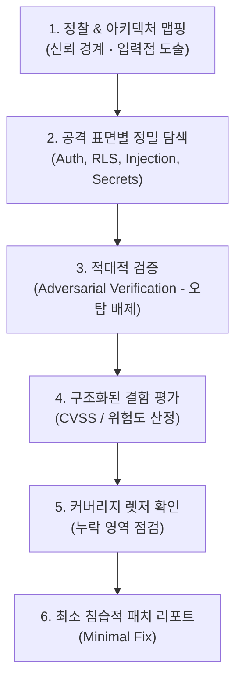

# 보안 감사 (Security Audit)

Cloudflare의 `security-audit-skill` 아키텍처에 기반한 다단계 방어적 보안 감사 워크플로우입니다. 단순 정적 분석 린터의 단순 경고를 넘어, **실제 익스플로잇 가능성(Exploitability)을 검증하고 오탐(False Positive)을 제거한 최소 수정 패치**를 도출합니다.

---

## 1. 6단계 감사 파이프라인 (Audit Pipeline)



### 1단계: 정찰 및 아키텍처 맵핑 (Reconnaissance)
- **신뢰 경계(Trust Boundaries):** 클라이언트(Next.js 브라우저), Edge/서버리스 핸들러, 백엔드 API, 외부 서드파티(금융/주식 API), Supabase DB 간의 경계 식별.
- **진입점(Entry Points):** 공개된 URL 라우트, API Route (`/api/...`), Server Actions, Webhook 엔드포인트 파악.
- **인증/인가 모델:** 세션 관리, JWT 검증, Role-based Access Control(RBAC), Row Level Security(RLS) 정책 조사.

### 2단계: 공격 표면별 탐색 (Coverage-Led Hunting)
코드베이스를 다음 5개 핵심 카테고리별로 분할 검토합니다.

1. **인증 및 인가 (Auth & Authorization):**
   - API 라우트/Server Action에서 사용자 세션 누락 (`supabase.auth.getUser()` 검증 여부).
   - IDOR (Insecure Direct Object Reference): 타 사용자의 리소스 ID를 임의 조회/수정 가능한지.
   - Supabase RLS(Row Level Security): 테이블별 RLS 활성화 여부 및 `auth.uid()` 바인딩 누락.
2. **주입 및 데이터 무결성 (Injection & Data Integrity):**
   - SQL Injection (ORM 우회 원시 쿼리, RPC 호출 검증).
   - XSS (Cross-Site Scripting): `dangerouslySetInnerHTML`, 검증되지 않은 Markdown 렌더링.
   - SSRF (Server-Side Request Forgery): 외부 URL을 fetch하는 서버 엔드포인트의 입력값 검증.
3. **시크릿 및 민감 정보 노출 (Secrets & Data Leakage):**
   - `NEXT_PUBLIC_` 접두사가 붙은 환경 변수에 Private API Key, Service Role Key 노출 여부.
   - 클라이언트로 반환되는 응답 페이로드에 민감 사용자 필드(해시, 토큰, 내부 메타데이터) 포함 여부.
   - 로그 파일이나 콘솔에 PII(개인식별정보) 또는 금융 인증 정보 기록 여부.
4. **클라이언트 측 보안 (Client-Side Security):**
   - 오픈 리다이렉트(Open Redirect) 취약점.
   - CORS 설정 및 CSRF 방어 상태.
   - 위험한 `postMessage` 또는 localStorage 내 민감 토큰 보관.
5. **의존성 및 공급망 (Supply Chain & Dependencies):**
   - 알려진 취약점(CVE)이 있는 오래된 npm 패키지 사용 여부.

### 3단계: 적대적 검증 (Adversarial Verification)
*발견된 후보 취약점(Candidate Findings)이 단순 의심인지 실제 위험인지 에이전트 자체 검증을 거칩니다.*

- **반증 시도:** "이 취약점이 실제 익스플로잇 불가능한 완화책(프레임워크 자동 이스케이프, 미들웨어 차단, DB 제약 조건 등)이 이미 존재하는가?"
- **판정 기준:**
  - `CONFIRMED`: 실제 코드 경로를 따라 외부 입력이 미검증 상태로 위험 싱크(DB, 렌더링, 외부 요청)에 도달함을 증명한 경우.
  - `MITIGATED`: 방어책이 동작 중이나 구조적 위험이 남아있는 경우.
  - `FALSE_POSITIVE`: 프레임워크나 상위 미들웨어에 의해 완전히 차단되는 경우 (폐기).

### 4단계 & 5단계: 평가 및 커버리지 렛저 (Ledger & Scoring)
- 심각도 산정: **Critical** / **High** / **Medium** / **Low** / **Informational**
- 누락 영역 기록: 이번 감사에서 테스트하지 못한 영역(예: 서드파티 웹훅, 오프라인 배치 등)을 명시하여 사각지대 방지.

### 6단계: 최소 침습적 패치 리포트 (Minimal Fix)
- 전체 리팩토링을 요구하지 않고, **취약점을 정확히 닫는 최소한의 코드 변경(Smallest Effective Diff)**을 제시합니다.

---

## 2. 주요 보안 감사 체크리스트 (Next.js & Supabase 특화)

| 영역 | 점검 대상 | 취약 패턴 (X) | 안전한 패턴 (O) |
|---|---|---|---|
| **Supabase RLS** | DB 테이블 보안 | RLS 미활성화 (`alter table ... disable row level security;`) | `ENABLE ROW LEVEL SECURITY;` + `auth.uid() = user_id` 정책 |
| **API 키 노출** | 환경 변수 관리 | `NEXT_PUBLIC_SUPABASE_SERVICE_ROLE_KEY` | 클라이언트는 `ANON_KEY`만, `SERVICE_ROLE_KEY`는 서버 환경에만 보관 |
| **세션 검증** | Server Actions / Route Handlers | `supabase.auth.getSession()` 만 믿고 DB 쿼리 실행 | `supabase.auth.getUser()`로 서버 인증 재검증 |
| **외부 데이터** | XSS 방어 | `dangerouslySetInnerHTML={{ __html: userContent }}` | `DOMPurify.sanitize()` 적용 또는 안전한 Markdown 파서 사용 |
| **금융/주식 API** | SSRF 방어 | 사용자 제공 URL로 서버에서 직접 `fetch(req.body.url)` | 허용 도메인 화이트리스트(`allowedHosts`) 검증 |

---

## 3. 리포트 출력 포맷

감사 완료 시 반드시 아래 표준 포맷으로 결과를 제공합니다:

```markdown
# [보안 감사 보고서] {모듈 / 대상}

## 1. 감사 개요 및 범위
- 검토 경로: `...`
- 검토 일자: YYYY-MM-DD
- 식별된 신뢰 경계: ...

## 2. 발견된 취약점 요약 (Confirmed Findings)
| ID | 심각도 | 취약점 명 | 대상 파일:라인 | 검증 상태 |
|---|---|---|---|---|
| SEC-01 | HIGH | Supabase RLS 우회 위험 | `src/app/api/...` | Confirmed |

## 3. 상세 분석 및 재현 경로 (Vulnerability Details)
### [SEC-01] {취약점 제목}
- **위치:** `[경로](file:///...)`
- **위협 시나리오:** 악의적인 사용자가 A 요청을 보낼 경우 B 데이터가 유출됨.
- **적대적 검증 결과:** 상위 미들웨어에 검증 누락 확인됨.

## 4. 권장 패치 (Minimal Fix)
\`\`\`diff
- // 취약한 코드
+ // 수정된 코드
\`\`\`

## 5. 커버리지 사각지대 (Audit Ledger)
- 점검하지 못한 외부 연동 지점 및 후속 권장 조치
```
