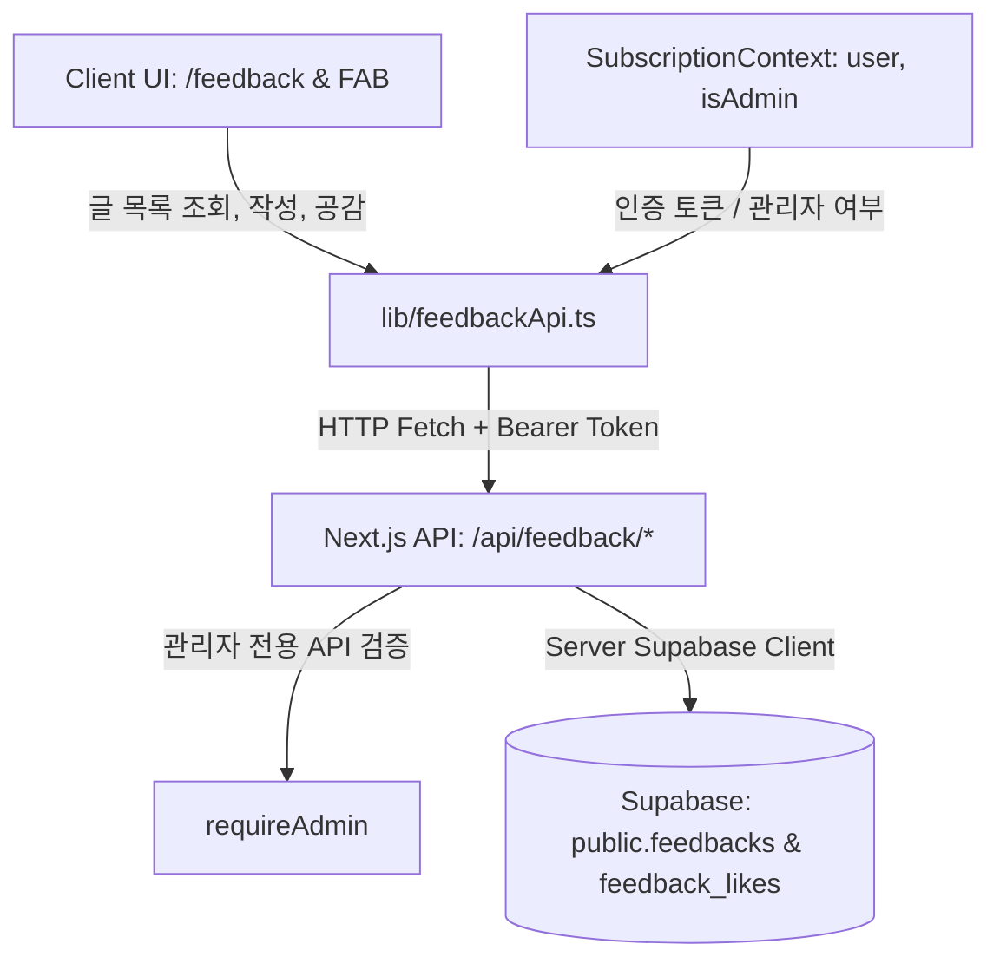

# Feedback 도메인 아키텍처 (Architecture)

## 1. 컴포넌트 구조 및 데이터 흐름

---

## 2. 권한 제어 매트릭스 (Authorization Matrix)

| 엔드포인트 | 메서드 | 비로그인 게스트 | 일반 로그인 사용자 | 관리자 (`is_admin = true`) |
| :--- | :--- | :--- | :--- | :--- |
| `/api/feedback` | GET | 공개 글 전체 조회 | 공개 글 + 본인 비공개 글 조회 | 비공개 글 포함 전체 조회 |
| `/api/feedback` | POST | 닉네임으로 등록 가능 | 프로필 자동 매핑 등록 | 등록 가능 |
| `/api/feedback/[id]/like` | POST | 1회 공감 투표 가능 | 1회 공감 투표 가능 | 1회 공감 투표 가능 |
| `/api/feedback/[id]/admin` | PATCH | 401/403 차단 | 403 차단 | 상태 변경 및 공식 답변 가능 |
| `/api/feedback/[id]/admin` | DELETE | 401/403 차단 | 403 차단 | 게시글 삭제 가능 |
