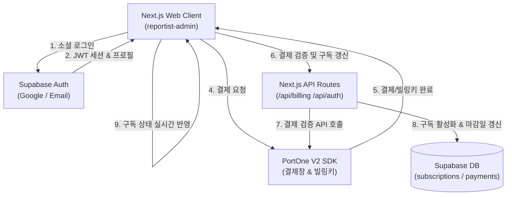
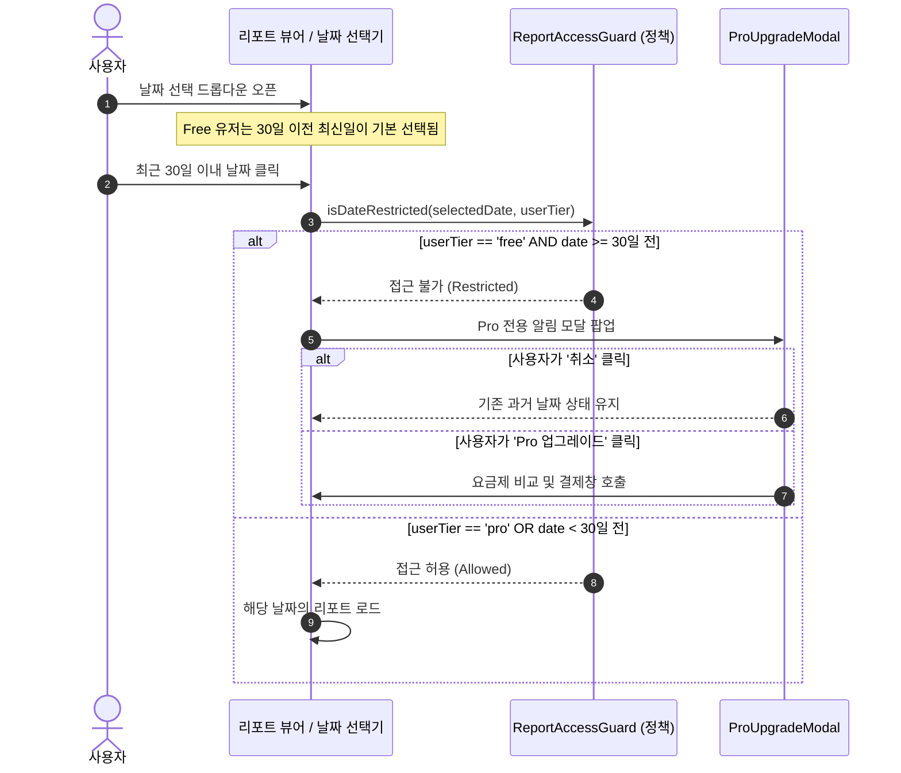
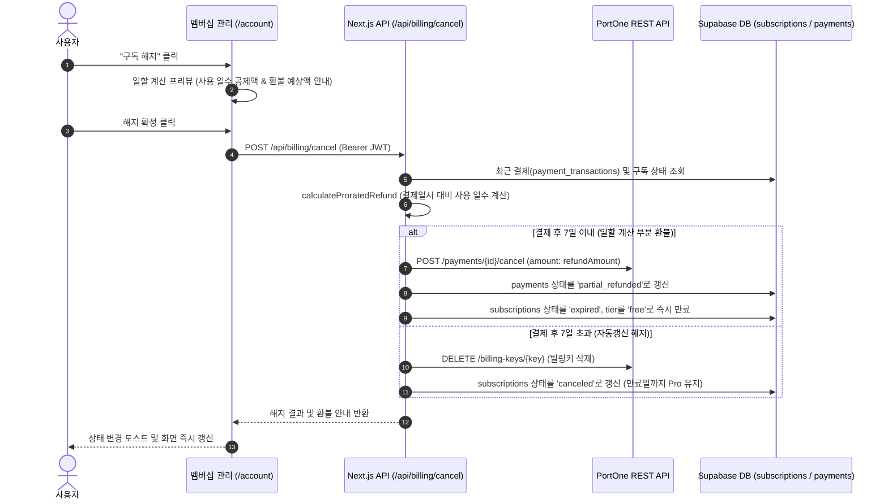

# Subscription & Auth 아키텍처 (architecture.md)

## 1. 시스템 구조 및 상호작용 (Mermaid)



---

## 2. 권한 판정 흐름도 (Date Guard)



---

## 3. 정기 결제(빌링키) 및 마감일 산출 로직

```typescript
export function calculateSubscriptionExpiry(
  currentPeriodEnd: Date | null,
  planType: 'monthly' | 'yearly',
  baseDate: Date = new Date()
): Date {
  // 기존 Pro 유효기간이 미래로 남아있으면 그 날짜 기준으로 연장, 아니면 현재 결제 시점 기준
  const startFrom = currentPeriodEnd && currentPeriodEnd > baseDate ? currentPeriodEnd : baseDate;
  const expiry = new Date(startFrom);

  if (planType === 'monthly') {
    expiry.setMonth(expiry.getMonth() + 1);
  } else if (planType === 'yearly') {
    expiry.setFullYear(expiry.getFullYear() + 1);
  }
  return expiry;
}
```

---

## 4. 해지 및 일할 부분 환불 흐름도 (Prorated Cancel Flow)



